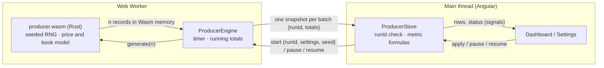

# Findev — Realtime Fintech Dashboard

An Angular app with a live market **Dashboard** and producer **Settings**. Simulated market
updates come from a **Wasm library written in Rust**, which runs inside a **Web Worker**.

- **Live demo:** https://vvitkus-dev.github.io/findev/ (the footer shows the deployed commit)
- **Repository:** https://github.com/vvitkus-dev/findev

## Build, run and test

Prerequisites: **Node 24** with npm 11 (`.nvmrc`), and **Rust via [rustup](https://rustup.rs/)**.
The Rust toolchain (1.99.0 with the `wasm32-unknown-unknown` target) is pinned in
`rust-toolchain.toml` and installed automatically on first use.

```bash
npm ci                 # install pinned dependencies
npm run wasm:build     # compile the Rust producer → public/wasm/producer.wasm (needed by start/build)
npm start              # dev server at http://localhost:4200
npm run build          # production build → dist/findev/browser

npm run test:unit      # Angular unit tests (Vitest)
npm run test:rust      # Rust generator tests (cargo test, plus rustfmt and clippy)
npm run test:wasm      # tests on the compiled producer.wasm (run wasm:build first)
```

Optional extras: `npm run e2e` runs Playwright end-to-end tests (needs
`npx playwright install chromium` once), and `npm run verify` runs every quality gate
(see [`docs/QUALITY_GATES_PLAN.md`](docs/QUALITY_GATES_PLAN.md)).

## How it works



- **Wasm (`wasm/producer`, Rust):** all randomness and price logic. It keeps each instrument's
  mid price, spread and book between calls and moves them a small random step per update.
  `generate(n)` writes `n` updates as 7 integers each,
  `[instrument, priceCents, tradeQty, bidCents, askCents, bidQty, askQty]`, which JavaScript
  reads directly from Wasm memory. TypeScript only supplies the random seed.
- **Worker:** loads the Wasm, generates a batch on every interval and adds each trade into
  running totals per instrument. It sends one small snapshot per batch, so the main thread
  never handles individual updates.
- **Main thread:** keeps the latest snapshot, ignores anything from an older run, computes the
  displayed metrics and renders them.

Design decisions the task leaves open:

| Decision                   | Choice                                                                                                                                                                              |
| -------------------------- | ----------------------------------------------------------------------------------------------------------------------------------------------------------------------------------- |
| Wasm language              | Rust: small output (under 64 KB), fast native tests, no runtime.                                                                                                                    |
| Wasm ↔ JS transport        | Raw C exports and a `Uint32Array` view on Wasm memory: no copies and no generated glue.                                                                                             |
| Where metrics are computed | The worker adds up running totals. The main thread derives spread, VWAP and imbalance from them. Only totals cross between threads, so state stays one row per instrument.          |
| Data flow worker → Angular | One snapshot message per batch → signals in a single `ProducerStore` service → table.                                                                                               |
| One producer               | One worker for the whole app, created at start-up. Navigation never creates another; Apply replaces only the Wasm generator inside it.                                              |
| Old runs                   | Every command and snapshot carries a `runId`. Both the worker and the store drop messages from other runs, so an old run can never overwrite a new one.                             |
| High rates                 | Heavy work stays in the worker. On a device that can't keep up, the table repaints at most 10 times a second with the latest totals; the caption says so. Every trade still counts. |

## Metrics

Per instrument, the worker keeps the last trade price, the latest bid/ask and book quantities,
`volume = Σ tradeQty` and `Σ(priceCents × tradeQty)`. No event history is kept.

| Metric    | Formula                                                       | Shown as "—" when                     |
| --------- | ------------------------------------------------------------- | ------------------------------------- |
| Last      | price of the latest trade                                     | no trade yet                          |
| Spread    | `ask − bid`                                                   | no quote yet                          |
| Volume    | `Σ tradeQty` since the run started (book quantities excluded) | never; starts at 0                    |
| VWAP      | `Σ(price × qty) / Σ qty` since the run started                | volume is 0                           |
| Imbalance | `(bidQty − askQty) / (bidQty + askQty)`, −1…+1                | no quote yet, or the denominator is 0 |

Prices are integer cents everywhere and rounded only for display. The status bar shows the
producer state, run number, nominal rate (`updatesPerBatch × 1000 / interval`, across all
instruments) and measured rate.

## Tests

| Area required by the task                                                 | Where                                                                                                                           |
| ------------------------------------------------------------------------- | ------------------------------------------------------------------------------------------------------------------------------- |
| Metrics: worked example, zero denominators, isolation between instruments | `core/producer/engine/metrics.spec.ts`, `shared/format/market-format.spec.ts`                                                   |
| Settings validation; reset when settings are applied                      | `producer-settings.spec.ts`, `settings-schema.spec.ts`, `settings.spec.ts`, `producer-store.spec.ts`, `app.integration.spec.ts` |
| Pause/resume; rejecting results from a previous run                       | `producer-engine.spec.ts`, `producer-engine-ordering.spec.ts`, `producer-store.spec.ts`                                         |
| Generator: batch sizes and valid values                                   | Rust tests in `wasm/producer/src`; `wasm-tests/producer.wasm.test.ts` on the compiled module                                    |

Tests use fixed seeds, a virtual clock and a fake worker, so none of them wait on real time.

## Deployment

GitHub Actions (`.github/workflows/ci-deploy.yml`) builds and tests every push. Pushes to `main`
also deploy to GitHub Pages automatically, then check the live site serves that commit. There
are no manual steps.

## Known limits

- **Measured rate** is slightly below nominal at the fastest settings (about 19,000/s against
  20,000/s), because a late timer isn't caught up. That's deliberate: no bursts after a pause.
- **Hidden tabs:** browsers slow down timers, so generation slows while the tab is hidden and
  simply continues when it returns.
- **Precision:** `Σ(price × qty)` stays an exact integer for about 12.5 hours of maximum load on a
  single instrument; after that the error is far below one cent.
- **Deploys only from `main`:** other branches build and run every test, but don't deploy.
