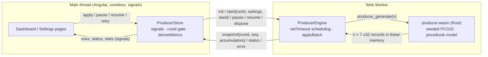

# Findev — Realtime Market Dashboard

An Angular 22 app showing live per-instrument market metrics. The simulated market updates are
produced by a **Rust library compiled to WebAssembly**, which runs inside a **Web Worker** so the UI
thread only renders.

- **Live demo:** https://vvitkus-dev.github.io/findev/ (redeployed on every push to `main`; the
  footer shows the deployed commit)
- **Repository:** https://github.com/vvitkus-dev/findev
- **Detailed plan and decision log:** [`docs/IMPLEMENTATION_PLAN.md`](docs/IMPLEMENTATION_PLAN.md),
  quality gates in [`docs/QUALITY_GATES_PLAN.md`](docs/QUALITY_GATES_PLAN.md)

Two pages:

- **Dashboard:** one row per instrument with last price, spread, volume, VWAP and order-book
  imbalance, plus the producer state, nominal vs measured throughput and Pause/Resume.
- **Settings:** instruments (1–50), updates per batch (1–1000) and batch interval (50–2000 ms),
  validated as you type. **Apply** starts a new run and resets the dashboard; editing alone
  changes nothing.

## Architecture



1. **Rust (`wasm/producer`)** owns all randomness and price logic: a seeded SplitMix64 → PCG32 RNG
   and a mid/spread/book random walk with the invariant `0 < bid < ask`. It exports a raw C ABI
   (no wasm-bindgen): `producer_generate` writes `n` records of 7 little-endian `u32` words,
   `[instrument, priceCents, tradeQty, bidCents, askCents, bidQty, askQty]`, into linear memory.
2. **The worker (`core/producer/engine`, framework-free TypeScript)** reads the records through a
   `Uint32Array` view (re-created after every call, because memory growth detaches the old
   buffer) and folds them into O(instruments) running sums. It posts one small snapshot per batch.
3. **The main thread (`ProducerStore`)** keeps only the latest snapshot, drops anything from an
   old run, and derives the displayed metrics with the pure `deriveMetrics`. OnPush components
   re-render only the bound text.

### Decisions and trade-offs

| Decision                   | Chosen                                                       | Why, and what was rejected                                                                                          |
| -------------------------- | ------------------------------------------------------------ | ------------------------------------------------------------------------------------------------------------------- |
| Wasm language              | Rust, `wasm32-unknown-unknown`                               | Tiny output (< 64 KB, checked), native `cargo test`. AssemblyScript reads as "TS in Wasm"; Emscripten is heavy.     |
| JS ↔ Wasm interface        | Raw C ABI + `Uint32Array` view                               | Zero copies, zero glue, explainable byte by byte. wasm-bindgen adds generated glue and copies arrays.               |
| Batch format               | Array of structs, 7 × `u32` (28 B/update)                    | One pointer, one view. JS objects per update would mean 20 000 allocations/s.                                       |
| Where metrics are computed | Sums in the worker, derivation on the main thread            | The UI thread never sees raw batches; stale runs are dropped whole. Both halves are pure, unit-tested functions.    |
| Worker lifecycle           | One worker per app, one Wasm generator per run               | Navigation can never create a producer; Apply is cheap. A new worker is created only by Retry after a fatal error.  |
| Scheduling                 | Worker-side `setTimeout`, delay `max(0, interval − elapsed)` | No overlapping ticks and no catch-up bursts after a pause or a throttled tab. `setInterval` was rejected for both.  |
| Run isolation              | `runId` on every command and snapshot, checked on both sides | Apply resets the rows synchronously; a late snapshot from the old run can never leak into the new one.              |
| State                      | `@Service()` store with signals                              | Idiomatic zoneless Angular 22. NgRx is heavy for one feature.                                                       |
| Forms                      | Signal Forms with a validation schema                        | The v22 recommendation for new forms; limits come only from `SETTINGS_LIMITS`.                                      |
| Hosting                    | GitHub Pages via GitHub Actions                              | Same platform as the repo, Rust and Node on one runner. Needs `--base-href /findev/` and a `404.html` SPA fallback. |

## Data model and formulas

The worker keeps, per instrument: last trade price, latest bid/ask quote and book quantities,
`volume = Σ tradeQty` and `notional = Σ priceCents × tradeQty`. No event history is kept.

| Metric    | Formula                                        | Shown as "—" when                      |
| --------- | ---------------------------------------------- | -------------------------------------- |
| Last      | price of the latest trade                      | no trade yet                           |
| Spread    | `ask − bid`                                    | no quote yet                           |
| Volume    | `Σ tradeQty` (book quantities are not volume)  | never (starts at 0)                    |
| VWAP      | `Σ(price × qty) / Σ qty`                       | volume is 0                            |
| Imbalance | `(bidQty − askQty) / (bidQty + askQty)`, −1…+1 | no quote yet, or `bidQty + askQty = 0` |

Prices stay integer cents end to end and are rounded only for display
(`shared/format/market-format.ts`). Throughput is shown twice: nominal,
`updatesPerBatch × 1000 / intervalMs` updates/s (spread across all instruments), and measured over
a sliding 1 s window.

## Prerequisites

- **Node 24** and npm 11 (`.nvmrc`)
- **Rust via [rustup](https://rustup.rs/)**. The toolchain (1.99.0, with the `wasm32-unknown-unknown`
  target, clippy, rustfmt and llvm-tools) is pinned in `rust-toolchain.toml` and installed
  automatically on first use.
- For `npm run verify` only: `cargo +1.99.0 install cargo-llvm-cov --version 0.9.1 --locked`
  (Rust coverage)

## Commands

```bash
npm ci                      # install exact, pinned dependencies
npm run wasm:build          # compile the Rust producer → public/wasm/producer.wasm (needed by npm start)
npm start                   # dev server at http://localhost:4200
npm run build               # production build → dist/findev/browser

npm run test:unit           # Angular unit + integration tests (Vitest, once)
npm run test:rust           # rustfmt --check, clippy (pedantic, -D warnings), cargo test
npm run test:wasm           # Node test suite on the real compiled producer.wasm (run wasm:build first)
npm run verify              # every gate: static checks, gate self-test, Rust, Wasm, unit tests, build
```

## Quality gates

Every threshold is a hard failure, and deploy is blocked unless all gates are green.

| Where                 | What runs                                                                                                                   |
| --------------------- | --------------------------------------------------------------------------------------------------------------------------- |
| Commit                | Prettier + ESLint on staged files (lint-staged), conventional commit messages (commitlint)                                  |
| Push                  | `npm run verify:fast`: static checks, Rust, Wasm suite, unit tests with coverage thresholds                                 |
| CI, every push and PR | `static` ∥ `self-test` ∥ `test` (Rust tests, mutants, coverage; Wasm build, ABI check, Wasm tests; unit tests; Pages build) |
| CI, `main` only       | `deploy` (needs all three) → `smoke` against the live URL, including the deployed commit SHA                                |

- **`npm run static`:** format check, ESLint with 0 warnings (architecture boundaries, complexity,
  size limits and the AAA test layout are lint rules), strict TypeScript, duplication ≤ 3 % (jscpd),
  dead code (knip), `npm audit`, and dependency age (every pin published ≥ 14 days ago).
- **Coverage:** ≥ 65 % global, ≥ 85 % for `core/producer`, `shared/format` and the Rust crate.
- **`npm run quality:self-test`:** proves each gate still fires by feeding it a deliberately bad
  input (lint, coverage, duplication, Rust, Wasm ABI, dependency age, git hooks, deploy smoke).
- **`npm run test:rust:mutants`:** injected Rust bugs must each make a test fail.

## Known limits

- **Number precision (D5):** `Σ price × qty` is a float64 that stays an exact integer below 2^53.
  At the maximum load on a single instrument that holds for about 12.5 hours; after that the
  relative error is about 1e-16, invisible once rounded to cents. BigInt was rejected as 10–50×
  slower in the hot loop.
- **Measured throughput** is a little under nominal at the fastest settings (about 18–19k/s vs
  20k/s at 50 ms), because timer lateness is not compensated; there is deliberately no catch-up.
- **Background tabs:** browsers throttle timers in hidden tabs, so throughput drops while hidden.
  When the tab returns, generation simply continues; there is no burst of catch-up batches.
- **Deploy only from `main`:** other branches and PRs run every gate but never deploy.
