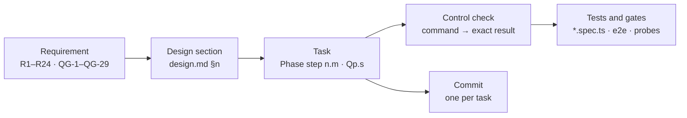

# Specs

This repo is built **spec-first**. Every feature and every bug fix starts as a spec, and code
follows the spec, never the other way round. A spec moves through three phases, each with its own
file:

| Phase           | File                        | Answers                                        | Contains                                                                                             |
| --------------- | --------------------------- | ---------------------------------------------- | ---------------------------------------------------------------------------------------------------- |
| 1. Requirements | `requirements.md` (feature) | **What** must be true, and how we know         | User stories, acceptance criteria in EARS form (`WHEN … THE SYSTEM SHALL …`), open decisions         |
| 1. Bug analysis | `bugfix.md` (bug fix)       | What is wrong, what must change, what must not | Current, expected and unchanged behaviour; root cause; regression test                               |
| 2. Design       | `design.md`                 | **How** it is built                            | Architecture decisions with trade-offs, contracts, sequence diagrams, error handling, test strategy  |
| 3. Tasks        | `tasks.md`                  | **In which steps**, and when each is done      | Checklist of discrete tasks, each linked to requirements and closed by a deterministic control check |

A phase starts only when the previous one is agreed. A task is ticked only when its control check
passes, and each task lands as one conventional commit.

## Traceability

Every link in the chain is explicit, so any line of code can be traced back to a requirement:

- `requirements.md` ends with a traceability table: requirement → design section → tasks → tests.
- Each task in `tasks.md` names the requirements it satisfies.
- Source comments cite the spec they implement, for example `specs/quality-gates/tasks.md Q1.2`.

## Index

| Spec                                                        | Type    | Scope                                                                | Status                                    |
| ----------------------------------------------------------- | ------- | -------------------------------------------------------------------- | ----------------------------------------- |
| [market-dashboard](market-dashboard/requirements.md)        | feature | The app: Wasm producer, worker, store, Dashboard and Settings, CI/CD | ✅ done (task 9.6 left for the interview) |
| [quality-gates](quality-gates/requirements.md)              | feature | Static and dynamic controls that gate every change                   | ✅ done (QG-28 open, QG-29 optional)      |
| [adaptive-repaint](adaptive-repaint/requirements.md)        | feature | Limit table repaints when the device can't keep up (refines R19)     | ✅ done                                   |
| [paused-rate](bugfixes/paused-rate/bugfix.md)               | bugfix  | Measured rate came back while paused                                 | ✅ fixed                                  |
| [layout-shift](bugfixes/layout-shift/bugfix.md)             | bugfix  | Layout moved while pages loaded and data arrived                     | ✅ fixed                                  |
| [first-frame-layout](bugfixes/first-frame-layout/bugfix.md) | bugfix  | First painted frame was missing bound content on slow CPUs           | ✅ fixed                                  |
| [deep-link-status](bugfixes/deep-link-status/bugfix.md)     | bugfix  | Deep links answered HTTP 404 on GitHub Pages                         | ✅ fixed                                  |
| [rust-lcov-folder](bugfixes/rust-lcov-folder/bugfix.md)     | bugfix  | Rust coverage failed on a fresh checkout                             | ✅ fixed                                  |

## Adding a spec

1. **Feature:** create `specs/<feature>/requirements.md` with user stories and EARS acceptance
   criteria, then `design.md`, then `tasks.md`. Reuse existing IDs when a feature refines a
   requirement (as `adaptive-repaint` refines R19).
2. **Bug fix:** create `specs/bugfixes/<slug>/bugfix.md` with current, expected and unchanged
   behaviour first. The regression test that reproduces the bug is the first task, and it must
   fail before the fix.
3. Add the spec to the index above. Implement task by task; tick a task only when its control
   check passes.

EARS patterns used in acceptance criteria:

| Pattern      | Template                                                   |
| ------------ | ---------------------------------------------------------- |
| Ubiquitous   | THE SYSTEM SHALL `<response>`                              |
| Event-driven | WHEN `<trigger>` THE SYSTEM SHALL `<response>`             |
| State-driven | WHILE `<state>` THE SYSTEM SHALL `<response>`              |
| Unwanted     | IF `<condition>` THEN THE SYSTEM SHALL `<response>`        |
| Optional     | WHERE `<feature is present>` THE SYSTEM SHALL `<response>` |
