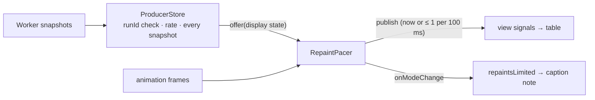
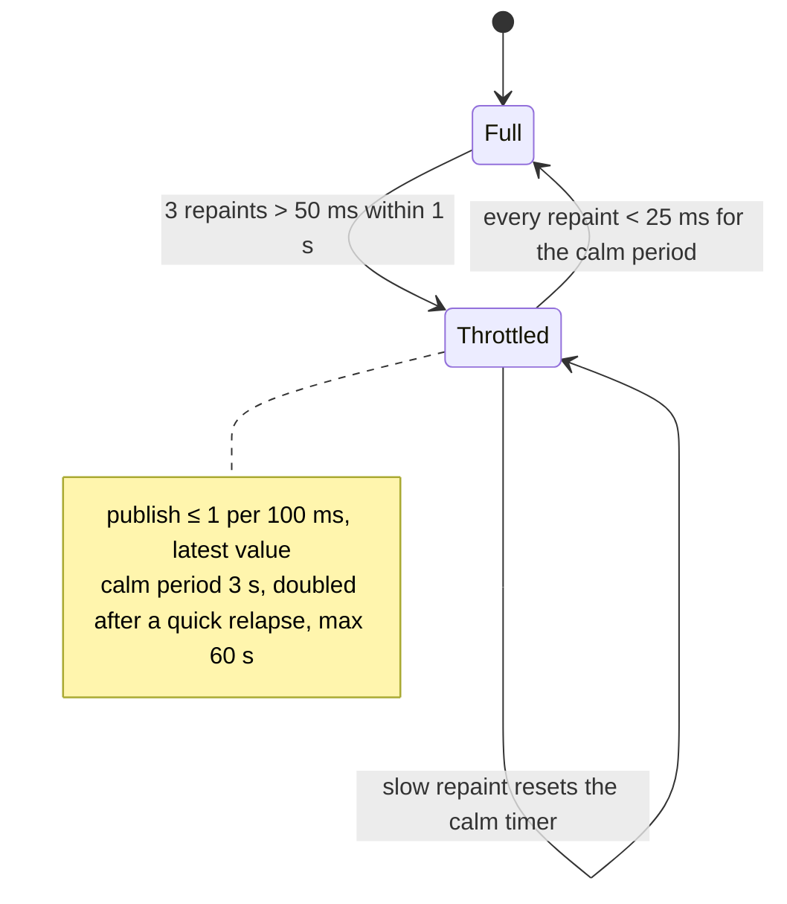

# Adaptive Repaint — Design

> Spec phase 2 of 3 · Previous: [requirements.md](requirements.md) · Next: [tasks.md](tasks.md)

## 1. Decisions

| Option                                                    | Verdict                                                                                                  |
| --------------------------------------------------------- | -------------------------------------------------------------------------------------------------------- |
| Fixed `requestAnimationFrame` coalescing                  | Rejected: fast devices don't need it, and it still repaints every frame on slow ones.                    |
| Fixed throttle (e.g. 10/s always)                         | Rejected: makes the normal case look laggy.                                                              |
| Throttle in the worker                                    | Rejected: the worker is not the bottleneck, and fewer snapshots would weaken run isolation and the rate. |
| **Adaptive pacer between the store and its view signals** | **Chosen**: full rate by default, throttles only when repaints are measured to be slow, with hysteresis. |

## 2. Component

`RepaintPacer<T>` (`src/app/core/producer/repaint-pacer.ts`) is framework-free. Animation frames,
timers and the clock are injected (`PacerDeps`), so tests drive it with `ManualFrames` and
`ManualScheduler` and never wait on real time (R22).

| API          | Used by                 | Effect                                                        |
| ------------ | ----------------------- | ------------------------------------------------------------- |
| `offer(v)`   | every accepted snapshot | publish now, or keep `v` as the pending value while throttled |
| `flush()`    | `pause()`               | publish the pending value now (AR8)                           |
| `drop()`     | `apply()`               | forget the pending value (AR7)                                |
| `start/stop` | store boot / destroy    | subscribe to and release animation frames                     |

## 3. Mode logic

A repaint's cost is the longest of the two frame gaps after it (the frame that runs it and the
frame that shows its cost), counted once per repaint. Frame gaps over 1 s (hidden tab) are ignored.
Defaults live in `PACER_DEFAULTS`.

## 4. Testing strategy

- Unit: `repaint-pacer.spec.ts` covers each mode change with exact frame timestamps.
- Integration with the store: `producer-store-pacing.spec.ts` covers apply/pause behaviour.
- Performance: a Chrome trace with 20× CPU slowdown and the accessibility tree on, at maximum load.
