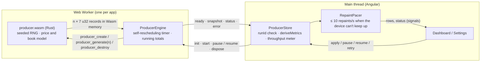
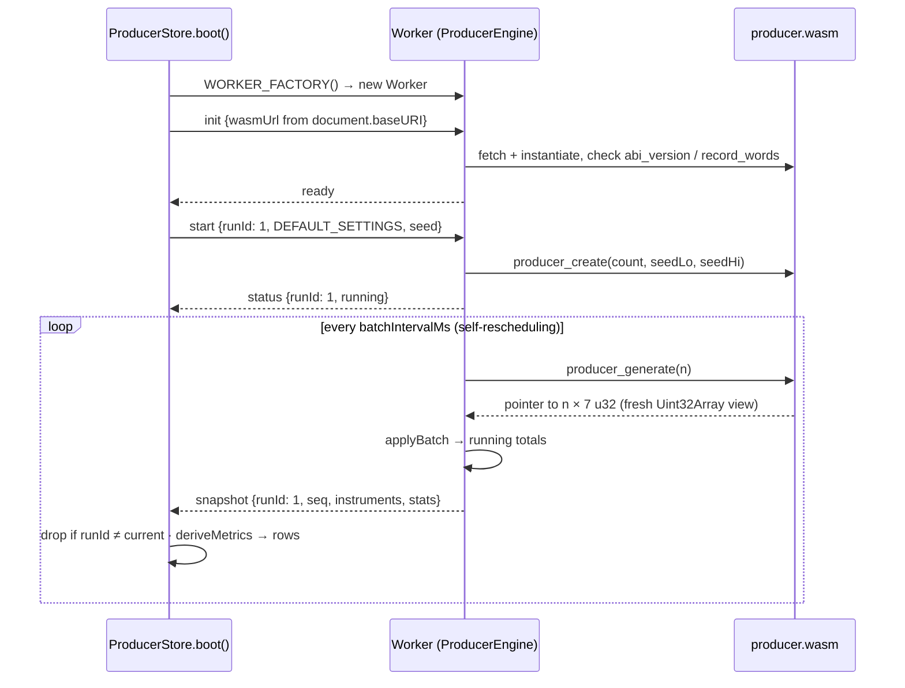
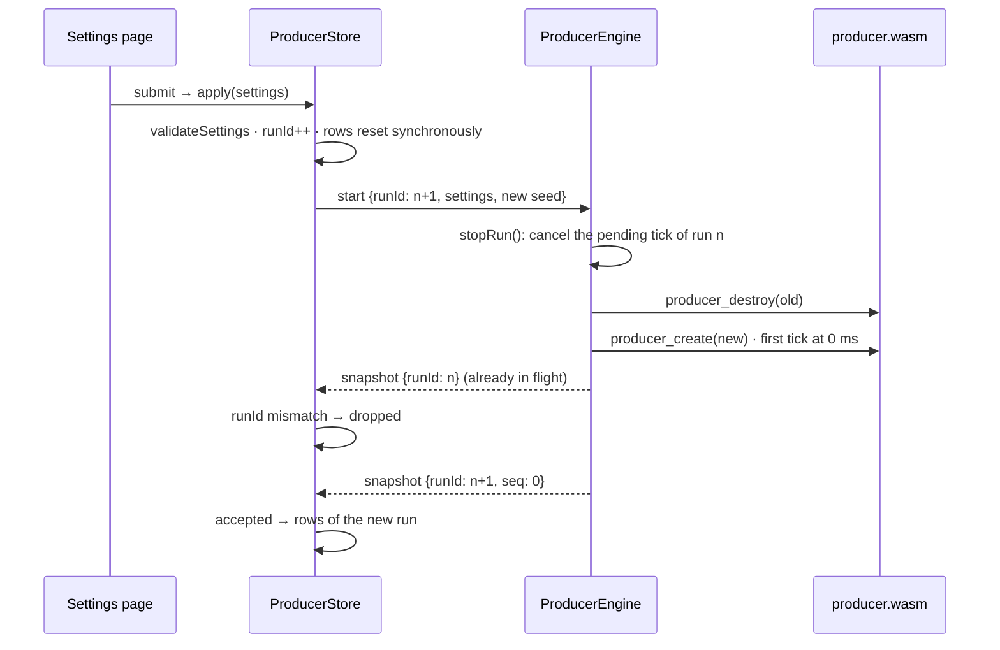
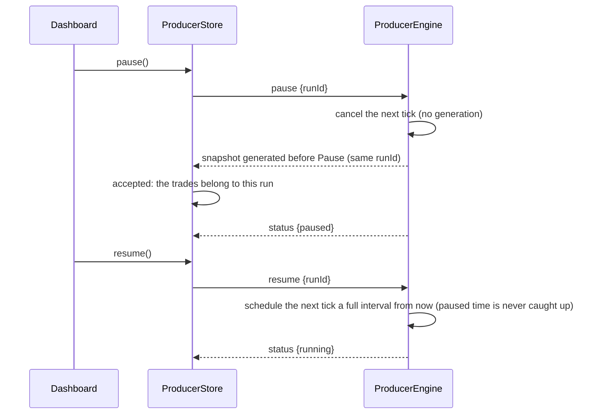
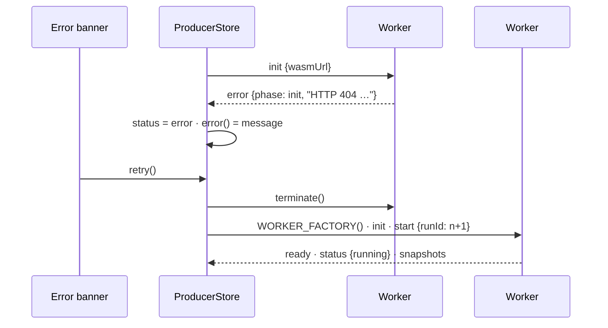

# Market Dashboard — Design

> Spec phase 2 of 3 · Previous: [requirements.md](requirements.md) · Next: [tasks.md](tasks.md)
>
> Baseline: Angular 22.2 (zoneless, standalone), TypeScript 6.0, Vitest 5 via
> `@angular/build:unit-test`, Node 24, Rust 1.99.0 (`wasm32-unknown-unknown`).

## Overview



## 1. Architecture decisions & trade-offs

### 1.1 Wasm language / toolchain

| Option                                     | Pros                                                                                                                                                              | Cons                                                                                                                   | Verdict                                                       |
| ------------------------------------------ | ----------------------------------------------------------------------------------------------------------------------------------------------------------------- | ---------------------------------------------------------------------------------------------------------------------- | ------------------------------------------------------------- |
| **Rust** (`wasm32-unknown-unknown`, cargo) | Industry standard for Wasm; zero-runtime output (~10–25 KB); `cargo test` gives native, fast generator tests; strong types; rustup preinstalled on GitHub runners | Extra local toolchain (rustup); learning curve for reviewers                                                           | **Chosen**                                                    |
| AssemblyScript                             | npm-only toolchain, TS-like syntax familiar to Angular devs                                                                                                       | Weaker credibility as "real Wasm" ("TS wrapped in Wasm" perception); thinner test ecosystem; less common in production | Rejected — risk of failing "not a trivial wrapper" perception |
| C/C++ + Emscripten                         | Mature                                                                                                                                                            | Heavy SDK (~1 GB), generated JS glue, slower CI                                                                        | Rejected                                                      |
| Zig / TinyGo                               | Small outputs                                                                                                                                                     | Niche, less explainable, smaller ecosystem                                                                             | Rejected                                                      |

### 1.2 JS ↔ Wasm interface

| Option                                                                                                               | Pros                                                                                                                                               | Cons                                                                                                                  | Verdict    |
| -------------------------------------------------------------------------------------------------------------------- | -------------------------------------------------------------------------------------------------------------------------------------------------- | --------------------------------------------------------------------------------------------------------------------- | ---------- |
| `wasm-bindgen` + `wasm-pack`                                                                                         | Ergonomic, generates TS types                                                                                                                      | Generated JS glue must be bundled into the worker; extra tool; returning arrays copies; harder to explain bytes-level | Rejected   |
| **Raw C ABI** (`#[unsafe(no_mangle)] extern "C"`), records written into linear memory, JS reads a `Uint32Array` view | Zero copies, zero glue, ~6 exported functions, fully explainable, loads with plain `WebAssembly.instantiate` in both browser worker and Node tests | Manual pointer handling; must re-create views if memory grows                                                         | **Chosen** |

Rules for the raw ABI (enforced by tests):

1. Every exported function is listed in `ABI_EXPORTS` and verified by `scripts/verify-wasm.mjs`.
2. JS creates the `Uint32Array` view **after** every `generate` call (memory may grow → old `ArrayBuffer` detached).
3. `abi_version()` export guards against stale artefacts.

### 1.3 Batch transport format inside the worker

| Option                                                | Pros                                      | Cons                              | Verdict                                      |
| ----------------------------------------------------- | ----------------------------------------- | --------------------------------- | -------------------------------------------- |
| JSON / JS objects per update                          | Readable                                  | 20 000 allocations/s, GC pressure | Rejected                                     |
| Struct-of-arrays (7 pointers)                         | Vectorisable                              | 7 views to manage                 | Rejected (complexity, no gain at this scale) |
| **Array-of-structs, 7 × `u32` per update (28 bytes)** | One pointer, one view, trivially iterable | —                                 | **Chosen**                                   |

Record layout (`#[repr(C)]`, little-endian `u32`): `[instrument, priceCents, tradeQty, bidCents, askCents, bidQty, askQty]`.

### 1.4 Where metrics are calculated

| Option                                                                            | Pros                                                                                                                                                 | Cons                                                                                                            | Verdict    |
| --------------------------------------------------------------------------------- | ---------------------------------------------------------------------------------------------------------------------------------------------------- | --------------------------------------------------------------------------------------------------------------- | ---------- |
| In Wasm                                                                           | Fastest                                                                                                                                              | Metric tests (worked example) would live in Rust; duplicating snapshot export ABI; harder for Angular reviewers | Rejected   |
| On main thread from raw batches                                                   | Simple worker                                                                                                                                        | Up to 28 KB × 20/s transferred and folded on UI thread; stale-run batches must be rolled back                   | Rejected   |
| **In the worker (TS accumulator), main thread receives O(instruments) snapshots** | Main thread only renders; transfer ≤ 50 small records per batch; accumulator is a pure TS module → easy Vitest tests; stale snapshots simply dropped | Accumulated state lives in worker (main has a copy via snapshots)                                               | **Chosen** |

Split: **accumulation** (`applyBatch` → raw sums) in worker; **derivation** (`deriveMetrics` → spread, VWAP, imbalance, nulls) is a pure function used by the main thread. Both in `metrics.ts`, both unit-tested.

### 1.5 Worker lifecycle across runs

| Option                                                                                                                  | Pros                                                                                         | Cons                                                                                                     | Verdict    |
| ----------------------------------------------------------------------------------------------------------------------- | -------------------------------------------------------------------------------------------- | -------------------------------------------------------------------------------------------------------- | ---------- |
| New worker per Apply                                                                                                    | Strongest isolation                                                                          | Re-fetch/compile Wasm each Apply; more lifecycle code paths; still needs `runId` because tests demand it | Rejected   |
| **One long-lived worker per app, one Wasm generator instance per run** (`producer_destroy` old → `producer_create` new) | Navigation can never create producers; cleanup per run is explicit and testable; cheap Apply | Must guard with `runId` (required anyway)                                                                | **Chosen** |

Worker is recreated only by the explicit "Retry" action after a fatal init error. Worker is terminated when the root injector is destroyed.

### 1.6 Scheduling

| Option                                                                                                        | Verdict                                                                        |
| ------------------------------------------------------------------------------------------------------------- | ------------------------------------------------------------------------------ |
| `setInterval`                                                                                                 | Rejected — overlapping ticks / bursts after throttling.                        |
| Main-thread timer sending "generate" commands                                                                 | Rejected — couples generation to UI-thread jank.                               |
| **Worker-side self-rescheduling `setTimeout` via injected `Scheduler`**, delay = `max(0, interval − elapsed)` | **Chosen** — no overlap, no catch-up bursts, testable with a manual scheduler. |

### 1.7 State management & change detection

| Option                                                                                                                  | Verdict                                                                                                                                                                                                                                         |
| ----------------------------------------------------------------------------------------------------------------------- | ----------------------------------------------------------------------------------------------------------------------------------------------------------------------------------------------------------------------------------------------- |
| NgRx Store                                                                                                              | Rejected — heavy for one feature; more to explain than to gain.                                                                                                                                                                                 |
| RxJS `BehaviorSubject` service                                                                                          | Viable, but more boilerplate in zoneless templates.                                                                                                                                                                                             |
| **`@Service()` singleton `ProducerStore` with Angular signals (private `signal`, public `.asReadonly()` / `computed`)** | **Chosen** — idiomatic Angular 22 (`@Service` is the v22 recommended singleton decorator, tree-shakable, no `providers` entry), zoneless-friendly, worker messages update signals → OnPush (v22 default) views re-render only bound text nodes. |

UI refresh rate: worker posts ≤ 1 snapshot per batch ⇒ ≤ 20 Hz worst case. Main thread stores only the _latest_ snapshot (no queue). Optional coalescing via `requestAnimationFrame` documented as a lever but not needed at 20 Hz × 50 rows.

### 1.8 Forms

| Option                                                                                                        | Verdict                                                                                                                                                                               |
| ------------------------------------------------------------------------------------------------------------- | ------------------------------------------------------------------------------------------------------------------------------------------------------------------------------------- |
| Template-driven                                                                                               | Rejected — validation harder to unit-test.                                                                                                                                            |
| Typed Reactive Forms (`NonNullableFormBuilder`)                                                               | Rejected — the `angular-developer` skill says new forms on v22+ should use Signal Forms; Reactive Forms is only for existing forms.                                                   |
| **Signal Forms (`@angular/forms/signals`: `form()`, `[formField]`, `required/min/max/validate`, `submit()`)** | **Chosen** — stable in v22, model is a plain `signal<ProducerSettings>` (fits the signals store), validation lives in one schema function, state is signals → trivial zoneless tests. |

Signal Forms rules that apply here (from `.claude/skills/angular-developer/references/signal-forms.md`):

- The form model is a **local draft** `signal({...store.settings()})`. It is a copy, so editing never touches the store (R9). The model must not contain `null`; numbers start at their current value.
- Put validation in the schema: `required`, `min`, `max` from `SETTINGS_LIMITS` with messages, and `validate()` returning `{kind:'integer', message}` for non-integers or `NaN` (an empty number input). A validator returns `undefined` when the value is valid, never `null`.
- **Forbidden on `[formField]` inputs:** `min`/`max` attributes, `[value]`, `[disabled]`. The schema handles them. `step="1"` and `inputmode="numeric"` are allowed.
- Apply goes through `submit(form, async () => store.apply(model()))`. `submit` marks all fields touched and runs the callback only when the form is valid. The Apply button uses `[disabled]="settingsForm().invalid()"`.
- Read field state by calling the field: `settingsForm.instrumentCount().errors()`. `settingsForm.instrumentCount.errors()` is wrong.

### 1.9 Hosting / CD

| Option                              | Pros                                                                                                                    | Cons                                                                                        | Verdict     |
| ----------------------------------- | ----------------------------------------------------------------------------------------------------------------------- | ------------------------------------------------------------------------------------------- | ----------- |
| **GitHub Pages via GitHub Actions** | Same platform as repo; no third-party account linking; Rust + Node on same runner; serves `.wasm` as `application/wasm` | Sub-path (`/<repo>/`) needs `--base-href`; no SPA fallback ⇒ copy `index.html` → `404.html` | **Chosen**  |
| Cloudflare Pages                    | SPA fallback, previews                                                                                                  | Its build image needs Rust installed manually; external account                             | Alternative |
| Vercel                              | Previews                                                                                                                | Same Rust issue; external account                                                           | Alternative |

---

## 2. Target structure

```
.
├── rust-toolchain.toml                 # pins Rust channel + wasm32 target (deterministic CI)
├── wasm/producer/
│   ├── Cargo.toml                      # cdylib, opt-level="s", lto, panic="abort", strip
│   └── src/
│       ├── lib.rs                      # extern "C" ABI only
│       ├── rng.rs                      # SplitMix64 seeding + xoshiro128** / PCG32
│       ├── model.rs                    # InstrumentState, price walk, book, trade
│       └── producer.rs                 # Producer { rng, instruments, buffer }
├── scripts/
│   ├── build-wasm.mjs                  # cargo build → public/wasm/producer.wasm → verify
│   ├── verify-wasm.mjs                 # asserts export names, abi_version, size budget
│   └── smoke-deploy.mjs                # curls live URL + wasm content-type
├── wasm-tests/
│   ├── vitest.config.mts               # environment: node
│   └── producer.wasm.test.ts           # runs the compiled module through wasm-generator.ts
├── public/wasm/                        # build output (git-ignored)
├── tsconfig.worker.json
├── src/app/
│   ├── app.ts / app.html / app.routes.ts / app.config.ts
│   ├── core/producer/
│   │   ├── engine/                     # FRAMEWORK-FREE (lint-enforced, Q0.4): runs in the worker / Node tests
│   │   │   ├── protocol.model.ts       # message types (main ⇄ worker) — models keep `.model.ts`
│   │   │   ├── producer-settings.model.ts  # interface ProducerSettings
│   │   │   ├── producer-settings.ts    # DEFAULT_SETTINGS, SETTINGS_LIMITS, validateSettings()
│   │   │   ├── symbols.ts              # 50 deterministic tickers
│   │   │   ├── metrics.ts              # accumulator + applyBatch + deriveMetrics
│   │   │   ├── scheduler.ts            # Scheduler/Clock interfaces + real impls
│   │   │   ├── wasm-generator.ts       # WebAssembly adapter
│   │   │   ├── producer-engine.ts      # worker-side state machine
│   │   │   └── producer.worker.ts      # thin adapter: self.onmessage → engine
│   │   ├── producer-tokens.ts          # WORKER_FACTORY, SEED_SOURCE, WASM_URL InjectionTokens
│   │   └── producer-store.ts           # @Service() ProducerStore — signals, runId gate
│   ├── shared/format/
│   │   ├── market-format.ts            # pure fns: formatCents, formatImbalance, formatVolume ("—" for null)
│   │   └── market-format-pipes.ts      # pure pipes delegating to the fns (cents | imbalance | volume)
│   └── features/
│       ├── dashboard/  dashboard.ts (class Dashboard), components/metrics-table.ts, components/producer-status.ts
│       └── settings/   settings.ts (class Settings, Signal Form), settings-schema.ts (validation schema)
├── .github/workflows/ci-deploy.yml
└── README.md
```

---

## 3. Key contracts (write these first; everything else depends on them)

### 3.1 Wasm ABI (`wasm/producer/src/lib.rs`)

```rust
// Rust 2024 edition: exported symbols need `#[unsafe(no_mangle)]` (verified with toolchain 1.99.0).
pub const ABI_VERSION: u32 = 1;
pub const RECORD_WORDS: u32 = 7;          // u32 words per update record
pub const MAX_INSTRUMENTS: u32 = 50;
pub const MAX_BATCH: u32 = 1000;

#[unsafe(no_mangle)] pub extern "C" fn abi_version() -> u32;
#[unsafe(no_mangle)] pub extern "C" fn record_words() -> u32;
/// Returns 0 (null) when instrument_count ∉ [1, MAX_INSTRUMENTS].
#[unsafe(no_mangle)] pub extern "C" fn producer_create(instrument_count: u32, seed_lo: u32, seed_hi: u32) -> *mut Producer;
/// Writes exactly `n` records into the producer-owned buffer; returns pointer to first record.
/// Returns 0 when producer is null or n ∉ [1, MAX_BATCH].
#[unsafe(no_mangle)] pub extern "C" fn producer_generate(p: *mut Producer, n: u32) -> *const u32;
#[unsafe(no_mangle)] pub extern "C" fn producer_destroy(p: *mut Producer);
```

`memory` is exported by default.

### 3.2 Generator model (all in Rust)

Per instrument state: `mid_cents: i64`, `spread_cents: u32`, `bid_qty: u32`, `ask_qty: u32`.

Per update:

1. `i = rng.below(instrument_count)` — instrument may repeat within a batch.
2. **Mid walk**: `delta = round(mid × u × 5 / 10_000)` with `u ∈ [−1, 1]`, at least ±1 cent with prob ½ (keeps low prices moving). `mid = max(MIN_MID=100, mid + delta)` (reflecting floor ⇒ price > 0 always).
3. **Spread**: random walk in `[1, max(1, mid/500)]` cents ⇒ `bid = mid − spread/2`, `ask = bid + spread`, then `bid = max(1, bid)`, `ask = max(ask, bid + 1)` ⇒ `0 < bid < ask`.
4. **Book**: `bid_qty`, `ask_qty` random walk with step ±50, clamped to `[0, 1000]` ⇒ ≥ 0, sum may be 0 (exercises zero-denominator path).
5. **Trade side**: buy-at-ask with probability `0.5 + 0.25 × imbalance` (imbalance from the book), otherwise sell-at-bid ⇒ `price ∈ {bid, ask}`.
6. **Trade qty**: `1 + rng.below(100)` ⇒ ≥ 1.
7. Initial mids: `rng` in `[1_000, 50_000]` cents per instrument at `producer_create`.

RNG: SplitMix64 to expand the 64-bit seed, PCG32 for draws. No external crates (avoids `getrandom` Wasm issues; smaller binary; fully explainable).

### 3.3 TypeScript generator adapter (`wasm-generator.ts`)

```ts
export interface MarketGenerator {
  /** Returns a view of n×7 u32 words. Valid only until the next generate/dispose call. */
  generate(n: number): Uint32Array;
  dispose(): void; // idempotent
}
export interface GeneratorFactory {
  create(instrumentCount: number, seed: readonly [number, number]): MarketGenerator;
}
export async function loadWasmGeneratorFactory(
  source: URL | ArrayBuffer,
): Promise<GeneratorFactory>;
// - verifies abi_version() === 1 and record_words() === 7, else throws WasmAbiError
// - instantiateStreaming when URL + correct MIME, falls back to arrayBuffer() + instantiate
```

### 3.4 Worker protocol (`protocol.model.ts`)

```ts
export interface ProducerSettings {
  instrumentCount: number;
  updatesPerBatch: number;
  batchIntervalMs: number;
}

export type ToWorker =
  | { type: 'init'; wasmUrl: string }
  | { type: 'start'; runId: number; settings: ProducerSettings; seed: [number, number] }
  | { type: 'pause'; runId: number }
  | { type: 'resume'; runId: number }
  | { type: 'dispose' };

export interface InstrumentAccumulatorDto {
  symbol: string;
  lastPriceCents: number | null;
  bidCents: number | null;
  askCents: number | null;
  bidQty: number | null;
  askQty: number | null;
  volume: number; // Σ qty
  notionalCents: number; // Σ price×qty
  trades: number;
}

export type FromWorker =
  | { type: 'ready' }
  | {
      type: 'snapshot';
      runId: number;
      seq: number;
      instruments: InstrumentAccumulatorDto[];
      stats: { batches: number; updates: number; lastBatchMs: number };
    }
  | { type: 'status'; runId: number; status: 'running' | 'paused' }
  | { type: 'error'; runId: number | null; phase: 'init' | 'runtime'; message: string };
```

### 3.5 Metrics (`metrics.ts`)

```ts
export function createAccumulators(instrumentCount: number): InstrumentAccumulatorDto[]; // nulls, zeros
export function applyBatch(acc: InstrumentAccumulatorDto[], words: Uint32Array, n: number): void; // O(n), no allocation
export interface InstrumentMetrics {
  symbol: string;
  lastPriceCents: number | null;
  spreadCents: number | null; // ask − bid
  volume: number;
  vwapCents: number | null; // notional / volume, unrounded
  imbalance: number | null; // (bq − aq)/(bq + aq)
}
export function deriveMetrics(a: InstrumentAccumulatorDto): InstrumentMetrics;
```

### 3.6 Main-thread store (`producer-store.ts`)

```ts
@Service() // v22 singleton decorator, replaces @Injectable({providedIn:'root'})
export class ProducerStore {
  // each public signal = private writable signal exposed via .asReadonly() or computed()
  readonly status: Signal<'initializing' | 'running' | 'paused' | 'error'>;
  readonly settings: Signal<ProducerSettings>;
  readonly runId: Signal<number>;
  readonly rows: Signal<InstrumentMetrics[]>; // computed from latest snapshot
  readonly stats: Signal<{ updatesPerSec: number; batches: number; updates: number }>;
  readonly error: Signal<string | null>;
  pause(): void;
  resume(): void;
  apply(settings: ProducerSettings): void; // validates, ++runId, resets rows, sends start
  retry(): void; // only from 'error': recreate worker
}
```

Dependencies injected: `WORKER_FACTORY` (`() => Worker`), `SEED_SOURCE` (`() => [number, number]`), `WASM_URL` (string). Tests replace all three.

---

## 4. Sequence flows

### 4.1 Boot (R10, R16, D4)



### 4.2 Apply new settings (R9, R12)



### 4.3 Pause and resume (R6, D7)



### 4.4 Init error and retry (R20)



---

## 5. Error handling

| Failure                                        | Detected by                                  | Behaviour                                                                                      | Requirement |
| ---------------------------------------------- | -------------------------------------------- | ---------------------------------------------------------------------------------------------- | ----------- |
| Wasm fetch fails (404, network)                | loader in the worker                         | `error {phase: init}` names the URL once and the HTTP status; banner with Retry                | R20         |
| Stale or incompatible artefact                 | `abi_version()` / `record_words()` check     | `WasmAbiError` → `error {phase: init}`                                                         | R20         |
| Invalid instrument count or batch size in Wasm | ABI returns null pointer                     | adapter throws `RangeError` → `error {phase: runtime}`; UI never sends invalid settings        | R8, R20     |
| Worker crashes or a message can't be cloned    | `worker.onerror`, `onmessageerror`           | `status = error`, message shown, Retry recreates the worker                                    | R20         |
| Message from an old run                        | `runId` check in the worker and in the store | dropped silently                                                                               | R12         |
| Wasm memory grows during `generate`            | design rule §1.2                             | a fresh `Uint32Array` view after every call; old views are never reused                        | R14         |
| Run replaced or app destroyed                  | `start` / root injector `onDestroy`          | `producer_destroy` before `producer_create`; `dispose` + `terminate()` on destroy              | R20         |
| Notional sum exceeds 2^53                      | analysis D5                                  | accepted: sub-cent relative error after about 12 h at maximum load; boundary test documents it | R17         |

## 6. Testing strategy

| Task requirement                                                             | Suite                                                                                                | Key cases                                                                                                                                            |
| ---------------------------------------------------------------------------- | ---------------------------------------------------------------------------------------------------- | ---------------------------------------------------------------------------------------------------------------------------------------------------- |
| Metric calculations, worked example, zero denominators, instrument isolation | `metrics.spec.ts`, `market-format.spec.ts`, `metrics-table.spec.ts`                                  | worked example exact numbers; empty ⇒ unavailable + volume 0; bq+aq = 0 ⇒ imbalance unavailable; instrument isolation; book qty excluded from volume |
| Settings validation & reset on apply                                         | `producer-settings.spec.ts`, `settings-schema.spec.ts`, `settings.spec.ts`, `producer-store.spec.ts` | boundaries, non-integers, required; editing doesn't apply; apply resets rows/stats and increments runId; apply from paused starts running            |
| Pause/resume & stale-run rejection                                           | `producer-engine.spec.ts`, `producer-store.spec.ts`                                                  | no generation while paused; no catch-up; totals preserved; stale snapshot / stale command ignored                                                    |
| Generator behaviour                                                          | Rust `cargo test` + `wasm-tests/producer.wasm.test.ts`                                               | exact batch sizes; invariants on 100k updates; determinism by seed; state continuity across calls; invalid input handling                            |

All time-dependent tests use `ManualScheduler`/fake `Clock`; all randomness uses fixed seeds. No test sleeps.

---

Layers, coverage thresholds, E2E scenarios and the AAA rule are specified in
[quality-gates design §3](../quality-gates/design.md#3-test-specification).

## 7. Risks

| Risk                                                                       | Likelihood        | Impact                                 | Mitigation                                                                                     |
| -------------------------------------------------------------------------- | ----------------- | -------------------------------------- | ---------------------------------------------------------------------------------------------- |
| Wasm 404 on GitHub Pages sub-path                                          | High if unhandled | App dead                               | URL from `document.baseURI` (D4); smoke test checks `/wasm/producer.wasm`                      |
| Detached `ArrayBuffer` after memory growth                                 | Medium            | Wrong/empty reads                      | Re-create view after every `generate`; Wasm test with growing batch sizes 1→1000               |
| Stale run data leak                                                        | Medium            | Spec violation                         | `runId` gate on both sides; dedicated tests (3.4, 4.3, 6.5)                                    |
| Angular 22 / Vitest 5 API drift (worker config, unit-test builder options) | Medium            | Build/test friction                    | Verify each config change with gate commands immediately; keep worker logic outside Angular    |
| Rust not installed for reviewers locally                                   | Medium            | Can't build                            | README prerequisites; `prestart` prints clear message if `cargo` missing; CI builds everything |
| Timer throttling in background tabs                                        | Low               | Lower throughput while hidden          | Accepted; start-to-start scheduling prevents bursts (9.4)                                      |
| Float precision of notional (D5)                                           | Very low          | Sub-cent error after ~12 h at max load | Documented; boundary test                                                                      |

---
